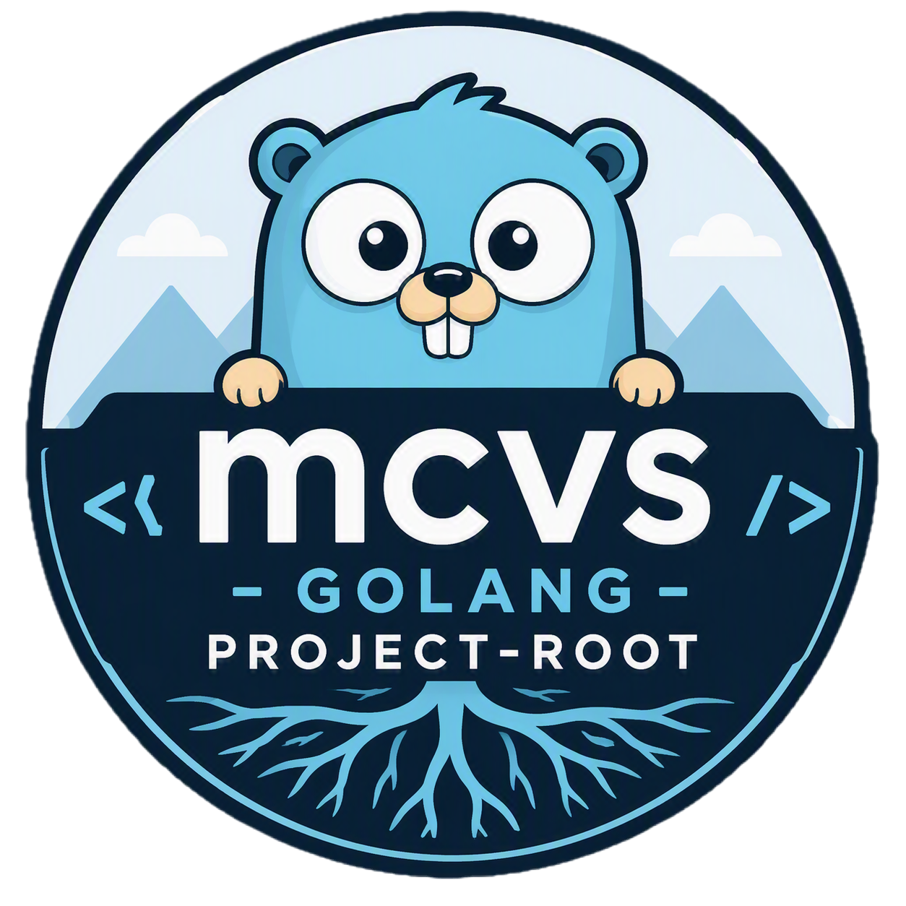

# mcvs-golang-project-root

[](https://github.com/schubergphilis/mcvs-golang-project-root/releases)
[](LICENSE)



A tiny Go library that resolves the root directory of a project by walking up
from the current working directory until it finds a `go.mod`.

## Quickstart

1. Add the module:

   ```zsh
   go get github.com/schubergphilis/mcvs-golang-project-root
   ```

2. Call `projectroot.FindProjectRoot()`:

   ```go
   package main

   import (
   	"github.com/schubergphilis/mcvs-golang-project-root/pkg/projectroot"
   	log "github.com/sirupsen/logrus"
   )

   func main() {
   	projectRoot, err := projectroot.FindProjectRoot()
   	if err != nil {
   		log.WithError(err).Fatal("unable to find project root")
   	}

   	log.Infof("project root found at: %s", projectRoot)
   }
   ```

3. Run the bundled example:

   ```zsh
   go run examples/main.go
   ```

## Documentation

- [Usage](docs/usage.md) - why and when to use this library, and resolving
  paths relative to the root
- [API](docs/api.md) - `FindProjectRoot` reference
- [Development](docs/development.md) - Task setup, common tasks and CI
